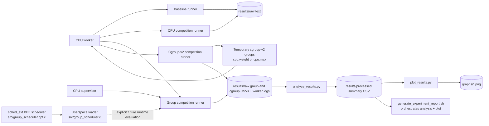

# Container-Aware Group CPU Scheduler

> **Project status:** The Linux `sched_ext` BPF scheduler and userspace loader
> are implemented, but have **not been validated at runtime**. Existing runner
> measurements use the default Linux scheduler. Do not claim a custom-scheduler
> comparison until it has been run and measured on a compatible Linux system.

## Overview

Containers often run side by side on the same machine and compete for CPU
time. This project explores how to account for CPU time by workload group,
with the longer-term goal of making CPU sharing between containers more
predictable and measurable.

The repository contains CPU-bound workloads and experiment runners, an
ordinary cgroup-v2 experiment path, and an early custom group scheduler built
with Linux `sched_ext` and eBPF. It also includes tools for analyzing and
plotting measurements. The custom scheduler is experimental code; the current
data and analysis tools do not establish that it improves scheduling.

## Problem and motivation

The default Linux scheduler schedules runnable tasks, but does not implement
this project's intended group-level weighted policy. Cgroup CPU controls can
apply relative weights (`cpu.weight`) or bandwidth limits (`cpu.max`), which
are useful controls and baselines. They do not exercise the custom scheduler's
own group accounting and dispatch policy.

The project therefore keeps these paths distinct: ordinary runs establish
workload behavior under the active default scheduler; cgroup runs test
standard cgroup CPU controls; and a future sched_ext evaluation will test the
custom policy under controlled conditions. A fair comparison still needs
repeatable workloads, useful per-group measurements, a compatible kernel,
and careful control of other CPU limits and system load.

## What is implemented

- **CPU worker and supervisor:** `workloads/cpu_worker.c` runs a synthetic
  CPU-bound loop for a requested duration and reports iterations. The C
  supervisor, `workloads/cpu_supervisor.c`, launches/reaps a worker, measures
  its user and system CPU time with `wait4()`, and tracks monotonic elapsed
  time. The group runner builds the supervisor for each run.
- **Baseline and CPU competition runners:** `scripts/run_cpu_baseline.sh`
  runs one worker; `scripts/run_cpu_competition.sh` runs 1–32 workers
  concurrently. They save timestamped text records in `results/raw/` and use
  the active default scheduler.
- **Group competition measurements:** `scripts/run_group_competition.sh`
  starts labeled groups of workers and writes per-worker CSV rows, including
  CPU time, elapsed time, iterations, and status. Group labels are metadata:
  this runner does not set cgroups, shares, quotas, priorities, or scheduler
  policy.
- **Cgroup-v2 experiment path:** `scripts/run_cgroup_competition.sh` checks
  for cgroup-v2 and CPU-controller access, or runs two workers in temporary
  child groups with explicit `cpu.weight` or `cpu.max` settings. It requires an
  already delegated, writable parent with CPU control enabled. It captures
  before/after `cpu.stat`, workload elapsed time, and exit status into a unique
  CSV under `results/raw/`. It uses the default Linux scheduler and does not
  attach sched_ext.
- **Custom scheduler and loader:** `src/group_scheduler.bpf.c` implements a
  sched_ext struct-ops scheduler with per-group dispatch queues and weighted
  virtual-time accounting. `src/group_scheduler.c` parses group cgroup IDs and
  shares, loads the BPF program, attaches it, and handles shutdown. The
  scheduler accepts 2–8 exact cgroup IDs plus a fallback share. This code
  builds only with the dependencies described below and still needs runtime
  validation on a suitable system.
- **Analysis and plotting:** `scripts/analyze_results.py` reads compatible
  group-competition and cgroup-competition CSV files. It derives per-worker
  CPU usage and Jain index for group runs, and cgroup CPU time, usage, and
  throttling summaries for cgroup runs. `scripts/plot_results.py` produces
  separate group-runner and cgroup measurement graphs when valid data exists
  (Matplotlib is needed to render figures).
- **Weighted fairness evaluation:** `scripts/evaluate_fairness.py` compares
  observed group CPU-time percentages with recorded relative shares and
  reports a separate equality-based Jain index. Current cgroup CSVs support
  `cpu.weight` comparison; existing group CSVs lack share values and cannot
  support weighted allocation error without added share metadata.
- **Repeated-run summaries:** `scripts/summarize_repeated_runs.py` groups
  compatible completed runs and reports descriptive metric statistics plus
  exclusion reasons. It preserves unavailable measurements and does not infer
  statistical significance.
- **Experiment suite and report generator:**
  `scripts/run_experiment_suite.sh` repeats the existing baseline and CPU
  competition runners and records a manifest. Its `--dry-run` option previews
  commands without launching workloads. `scripts/generate_experiment_report.sh`
  analyzes existing group-competition CSVs and plots the derived summary; it
  does not run workloads.

Implemented code is not the same as validated runtime behavior. In particular,
the custom scheduler has not yet been attached and evaluated in a supported
runtime environment. The ordinary cgroup path is also dependent on the target
machine's delegation and has not been presented here as a completed controlled
evaluation.

## Architecture



The dotted scheduler relationship indicates a future evaluation setup, not an
automatic connection: no runner starts the loader. The suite covers baseline
and CPU competition only. Cgroup experiments use kernel cgroup controls rather
than the custom scheduler.

## Repository structure

| Path | Purpose |
| --- | --- |
| `src/` | sched_ext BPF policy and userspace loader source |
| `include/` | Shared scheduler configuration definitions |
| `workloads/` | CPU worker and worker supervisor source |
| `scripts/` | Workload runners, cgroup setup and `cpu.stat` CSV helper, experiment suite, analysis, plotting, report wrapper |
| `tests/` | Python `unittest` coverage for validation and analysis/report logic |
| `docs/` | Detailed runner, scheduler, cgroup, experiment, and analysis guides |
| `results/raw/` | Append-only runner outputs; preserve original records |
| `results/processed/` | Derived summaries, suite manifests, and report directories |
| `graphs/` | Generated plots; filenames are unique to avoid overwriting |
| `Makefile` | Builds the custom sched_ext loader and generated BPF artifacts |

## Quick start

From the repository root, inspect the available files and script interfaces:

```sh
rg --files
bash scripts/run_experiment_suite.sh --help
bash scripts/run_cgroup_competition.sh --help
python3 scripts/analyze_results.py --help
python3 scripts/plot_results.py --help
bash scripts/generate_experiment_report.sh --help
```

Run safe checks that do not start workloads or require cgroup privileges:

```sh
bash -n scripts/*.sh
python3 -m unittest discover -s tests -v
bash scripts/run_experiment_suite.sh --dry-run
```

The test suite uses temporary files/directories and does not require a
sched_ext-capable kernel. The cgroup check is read-only, but may correctly fail
on a machine without a writable delegated cgroup parent:

```sh
bash scripts/run_cgroup_competition.sh --check
```

To build the ordinary CPU worker before running workload examples:

```sh
gcc -O2 -Wall -Wextra -std=c11 workloads/cpu_worker.c -o workloads/cpu_worker
```

The `make` target builds the **custom scheduler loader**, not the workload. It
requires Clang with BPF support, `bpftool`, libbpf development files (version
1.5 or newer), readable kernel BTF, and sched_ext compatibility headers. See
`docs/scheduler-design.md` before attempting that build.

Run the read-only custom-scheduler readiness diagnostic before arranging a
build or runtime validation:

```sh
python3 scripts/check_scheduler_readiness.py
```

It reports kernel/architecture, BTF, sched_ext state, compiler/tool and libbpf
prerequisites, and the Makefile's reference sched_ext header paths. Use
`--scx-root PATH` (or `SCX_ROOT`) when the reference checkout is not at
`~/scx-c-examples`. A nonzero status means a required prerequisite is missing
or sched_ext is not currently disabled. The diagnostic is read-only, its WSL
classification is only a heuristic, and a clean report does not establish
that the kernel supports or will accept this scheduler.

## Examples

### Default-scheduler workloads

These commands execute CPU workloads and write new files under `results/raw/`:

```sh
scripts/run_cpu_baseline.sh 3
scripts/run_cpu_competition.sh 4 5
```

The first runs one worker for three seconds. The second starts four workers,
each for five seconds. Neither command applies cgroup controls or attaches the
custom scheduler.

To run the labeled, measured group runner (also executes workers):

```sh
scripts/run_group_competition.sh latency=2 batch=2 3
```

`latency`, `batch`, and `background` are labels only. This is not a latency
benchmark and does not impose group shares.

### Ordinary cgroup-v2 controls

First check the default cgroup root or provide a delegated parent:

```sh
bash scripts/run_cgroup_competition.sh --check --parent "$HOME/delegated-cgroup"
```

This check is read-only. Preview a two-group weight setup without writes or
workload execution:

```sh
bash scripts/run_cgroup_competition.sh --dry-run --parent "$HOME/delegated-cgroup" \
  --weight-a 200 --weight-b 100 --duration 5
```

Run the actual cgroup experiment (executes two workers and writes only within
the delegated cgroup subtree):

```sh
bash scripts/run_cgroup_competition.sh --parent "$HOME/delegated-cgroup" \
  --weight-a 200 --weight-b 100 --duration 5
```

The script requires the parent to be writable and the CPU controller already
enabled for child cgroups. It does not use `sudo`, enable controllers, change
global CPU settings, or attach sched_ext. See
[`docs/cgroup-experiments.md`](docs/cgroup-experiments.md) for quota examples
and cleanup behavior.

### Analyze competition CSVs and generate plots

Analyze both supported result formats (read-only raw inputs):

```sh
python3 scripts/analyze_results.py --output results/processed/summary.csv
python3 scripts/plot_results.py results/processed/summary.csv
```

With no input paths, the analyzer reads both `group_competition_*.csv` and
`cgroup_competition_*.csv` from `results/raw/`, excluding the documented
incomplete debugging artifact. The commands above therefore include both
formats when their raw files are present. Explicit paths can also be combined
as `python3 scripts/analyze_results.py path/to/group.csv path/to/cgroup.csv --output results/processed/summary.csv`.
If the requested summary filename already exists, a unique suffix preserves it.

To plot an existing summary separately:

```sh
python3 scripts/plot_results.py results/processed/group_summary.csv
```

This writes unique PNGs under `graphs/` if usable measurements exist and
Matplotlib is installed. The combined report command also only analyzes and
plots existing data; it does not run workloads:

```sh
bash scripts/generate_experiment_report.sh \
  --graphs-dir graphs results/raw/group_competition_RUN.csv
```

### Evaluate weighted group allocation

After collecting cgroup `cpu.weight` results, calculate observed and expected
group CPU shares and write a new evaluation CSV:

```sh
python3 scripts/evaluate_fairness.py results/raw/cgroup_competition_*.csv \
  --output results/processed/fairness.csv
```

The evaluator computes signed allocation error in percentage points and a
separate Jain index for equality among measured groups. A 2:1 allocation can
match 2:1 configured shares exactly while having Jain index 0.9; equal Jain
fairness is not the goal when configured shares differ. It refuses to
overwrite input or existing files. See
[`docs/fairness-evaluation.md`](docs/fairness-evaluation.md) for supported
schemas, exclusions, and output fields. Synthetic test data is confined to
temporary unit-test files and is never mixed with experiment results.

### Summarize repeated runs

Generate unique CSV and Markdown summaries from compatible completed runs:

```sh
python3 scripts/summarize_repeated_runs.py \
  results/raw/group_competition_*.csv \
  results/raw/cgroup_competition_*.csv \
  results/raw/custom_scheduler_run_*.csv \
  --output-dir results/processed/repeated
```

Each configuration is summarized separately. The report includes mean,
median, sample standard deviation, and per-metric sample count for available
CPU time, CPU usage, elapsed time, cgroup throttling, Jain fairness, and
share-weighted allocation error. Add `--repeated-summary` to
`generate_experiment_report.sh` to include these outputs in its report
directory. See [`docs/results-analysis.md`](docs/results-analysis.md) for the
aggregation rules, exclusions, and limits.

### Custom scheduler build and future runtime evaluation

Build the loader only on a machine with the required BPF, libbpf, BTF, and
sched_ext headers:

```sh
make
# or, if the sched_ext source tree is elsewhere:
make SCX_ROOT=/path/to/scx-c-examples
```

This build does not attach the scheduler. Running `build/group_scheduler`
would explicitly load and attach sched_ext and requires a compatible kernel,
suitable privileges, carefully prepared cgroups, and a recovery plan. The
loader's actual configuration is `--fallback-share SHARE` plus at least two
`--group CGROUP_ID:SHARE` options. Do not run it as a routine quick-start
command; the custom scheduler has not yet been runtime validated. See
[`docs/scheduler-design.md`](docs/scheduler-design.md).

## Metrics: available and missing

- **Elapsed time:** The group runner records monotonic elapsed time per worker.
  The CPU competition runner records total run elapsed time at centisecond
  resolution. The baseline record includes requested duration and worker
  output, but does not independently measure elapsed time. The cgroup runner
  records per-group workload elapsed time from `/proc/uptime` at centisecond
  resolution, including small launch and wait overhead.
- **CPU time:** The group runner's C supervisor records direct-worker user and
  system CPU time using `wait4()`; `cpu_time_s` is their sum. It does not
  include arbitrary descendants. The baseline and CPU competition text
  runners do not collect per-worker CPU time. The cgroup runner records
  cgroup-level `usage_usec`, `user_usec`, and `system_usec` deltas, which may
  include small runner overhead and are not worker-only measurements.
- **CPU usage percentage:** The analyzer derives
  `100 * cpu_time_s / elapsed_s` for a worker. This is average use as a
  percentage of one CPU over that worker's interval, not total machine CPU
  utilization. It can be unavailable or slightly above 100% due to interval
  and accounting differences.
- **Jain's fairness index:** The analyzer derives
  `(sum(cpu_time)^2) / (n * sum(cpu_time^2))` from workers with valid CPU-time
  measurements in a run. It describes equality among workers (1.0 means equal
  CPU time), not weighted fairness between groups or scheduler quality.
- **Throttling and latency:** The group-results analyzer does not collect
  cgroup `cpu.stat` throttling deltas. The cgroup analyzer converts valid
  `usage_usec_delta` into CPU seconds and average CPU usage percentage, and
  reports `nr_throttled_delta` (throttled periods), `throttled_usec_delta`
  converted to seconds, and throttled-period percentage when the period count
  is valid. The cgroup runner records cgroup-level
  before/after values for `usage_usec`, `user_usec`, `system_usec`,
  `nr_periods`, `nr_throttled`, and `throttled_usec`, plus per-group workload
  elapsed time and exit status. It does not measure request or tail latency,
  fairness, or scheduler overhead. The worker reports iterations, which are
  not a latency or fairness measurement. Missing or invalid kernel counters
  are written as `NA`; see [`docs/cgroup-experiments.md`](docs/cgroup-experiments.md)
  for the CSV schema.

The plotting tool can graph per-worker CPU usage and Jain index for group
results, and cgroup CPU usage and throttling in separate graphs. Cgroup
measurements use the default Linux scheduler and must not be presented as
custom sched_ext results. The graphs preserve that distinction in their titles.

## Requirements and platform limitations

The CPU worker requires a C compiler such as GCC. The ordinary runners use
Bash and standard Linux utilities. Python 3's standard library is sufficient
for analysis; Matplotlib is required only when plots with usable data are
rendered. The scheduler build additionally requires Clang BPF support,
`bpftool`, `pkg-config`, libbpf development files version 1.5 or newer,
readable `/sys/kernel/btf/vmlinux`, and sched_ext headers (by default under
`~/scx-c-examples`).

In the repository's tested WSL2 environment (kernel
`6.6.87.2-microsoft-standard-WSL2`), the sched_ext interface is not exposed, so that environment
cannot validate attaching the custom scheduler. Runtime evaluation needs a
Linux kernel with sched_ext support and the relevant interfaces enabled; the
task-cgroup lookup path also depends on kernel support described in the
scheduler design document.

Cgroup experiments need cgroup v2, an already delegated writable parent, and
the CPU controller enabled for child groups. A cgroup-v2 mount alone is not
enough. The script intentionally does not enable controllers or request
privileges. Use a parent set up by the system administrator or experiment
environment.

## Current status and limitations

The project has an initial BPF group scheduler, a loader, ordinary workload
runners, cgroup controls, and analysis utilities. **The custom scheduler has
not yet been validated at runtime.** Existing result files are from ordinary
default-scheduler runs and development checks; they are not evidence of custom
scheduler behavior. Do not claim a custom-scheduler speedup, fairness result,
or successful runtime test until a controlled evaluation is performed on
supported hardware and kernel.

The scheduler matches exact cgroup IDs, uses a single fallback group, and
assumes group membership remains unchanged while it is attached. Shares are
not reservations; the policy does not implement hierarchy-aware accounting,
dynamic share updates, migration-aware accounting, or a runtime statistics
interface. Analysis supports the default-scheduler cgroup CSV separately; it
does not compare these measurements to custom sched_ext results.

## Future work

1. **Build and runtime validation:** build on a sched_ext-capable Linux host;
   check verifier/load/attach behavior, shutdown, and recovery before measuring.
2. **Cgroup evaluation:** collect repeated cgroup runs and interpret quota
   throttling carefully alongside host load and parent-level limits.
3. **Controlled comparisons:** run repeated, documented baseline, cgroup, and
   custom-scheduler cases with fixed workloads, group membership, machine
   conditions, and scheduler configuration.
4. **Analysis and plots:** extend comparisons only when custom scheduler
   measurements and compatible metrics have been collected.
5. **Final evaluation:** report limitations, variability, and results from
   actual institute-PC measurements; do not substitute synthetic or
   unvalidated outcomes.

## Contributing and safety

Before submitting a change, run the non-privileged test suite and shell syntax
checks:

```sh
python3 -m unittest discover -s tests -v
bash -n scripts/*.sh
```

Tests do not require sched_ext runtime support. Preserve existing raw results;
analysis writes derived output separately. Workload commands consume CPU and
write new result records. Cgroup runs modify settings only inside the
explicitly selected delegated subtree and should be started deliberately.
Loading the custom scheduler requires an explicit invocation, a compatible
kernel, suitable privileges, prepared cgroups, and a recovery plan. No build,
test, or report command in this README automatically attaches it.
## Custom scheduler experiments

The custom-scheduler harness has explicit `prepare`, `check`, and `run` modes.
`prepare` writes unique manifest/CSV files without attaching or starting
workloads. All three modes validate 2 to 8 unique cgroup identities, each
configured share and fallback share in 1..10000, and the loader's combined
share limit:

```sh
python3 scripts/run_custom_scheduler_experiment.py prepare --duration 10 \
  --fallback-share 100 \
  --group latency:12345:100:/sys/fs/cgroup/test/latency \
  --group batch:12346:300:/sys/fs/cgroup/test/batch
```

Obtain each expected ID with
`python3 scripts/prepare_custom_scheduler_experiment.py --identify-cgroup PATH`;
the harness independently verifies every ID/path pair before writing files.
Use `make` and `make workloads`, then run the read-only prerequisite check:

```sh
python3 scripts/run_custom_scheduler_experiment.py check --duration 10 \
  --fallback-share 100 \
  --group latency:12345:100:/sys/fs/cgroup/test/latency \
  --group batch:12346:300:/sys/fs/cgroup/test/batch
```

Only the explicit `run` subcommand attempts attachment and workload launch.
It requires a compatible sched_ext kernel, usable BTF/libbpf-built artifacts,
attach permissions, verified writable cgroups, and a recovery plan. It records
custom scheduler shares separately from cgroup `cpu.weight` and `cpu.max`.
Completed raw run CSVs can be passed directly to
`scripts/evaluate_fairness.py`; prepared and incomplete runs retain unavailable
measurements and are excluded from allocation comparisons.
Attachment failure aborts without starting workers or falling back to ordinary
Linux scheduling. No runtime success is claimed here; mocked tests do not
validate kernel attachment or shutdown. See
[`docs/custom-scheduler-experiments.md`](docs/custom-scheduler-experiments.md)
for exact run invocation, readiness/shutdown behavior, schema, and limits.
